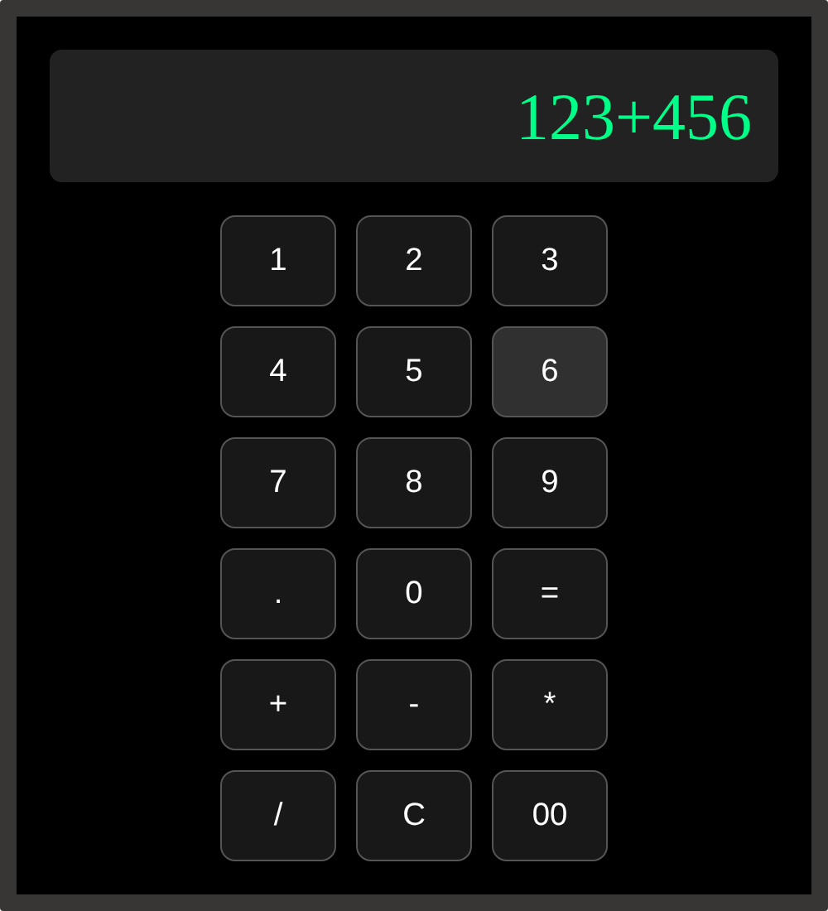

# Awesome Calculator

## Screenshot

A simple calculator built with HTML, CSS, and JavaScript.

## Features
- Basic operations: add, subtract, multiply, divide
- Clear button and decimal support
- Error handling for invalid input

## How to run
Open `index.html` in a browser, or visit the live demo:  [Live Demo](https://awesome-calculator-ashen.vercel.app/)

## What I learned
- Selecting elements with getElementById and querySelectorAll
- Handling click events with addEventListener
- Why eval() is convenient but unsafe in production apps